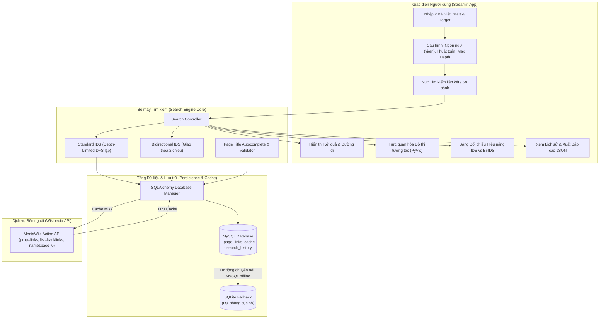
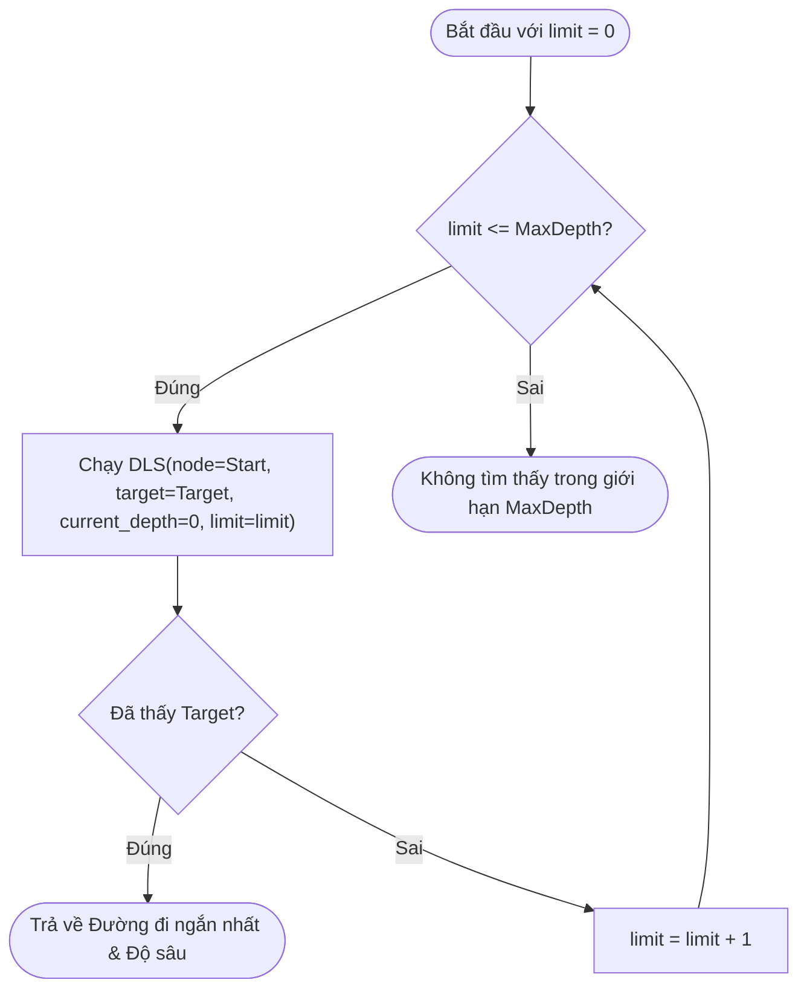
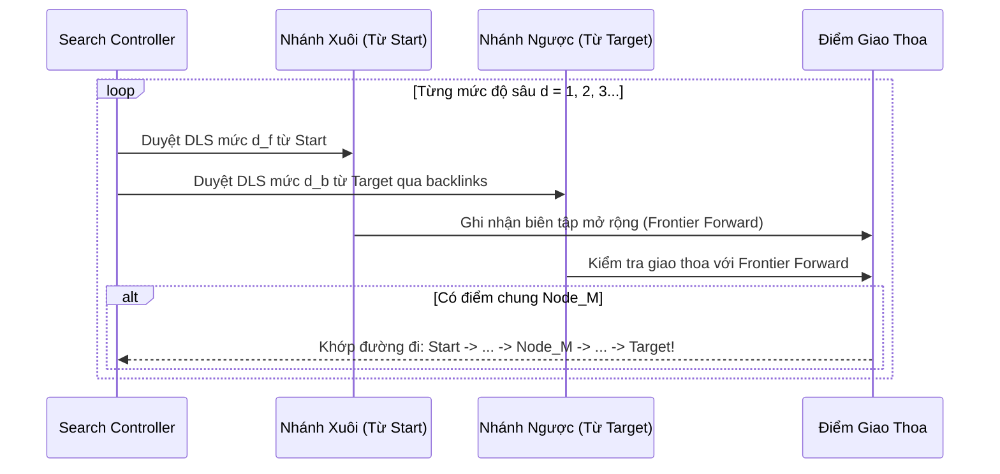

# Kế Hoạch Triển Khai: SixDegreesOfWiki - Hệ Thống Phân Tích Mức Độ Liên Kết Wikipedia Bằng Iterative Deepening Search (IDS)

> [!NOTE]
> Dự án giải quyết bài toán kinh điển **Six Degrees of Wikipedia** (Tìm khoảng cách phân tách giữa 2 khái niệm bất kỳ trên bách khoa toàn thư Wikipedia) thông qua giải thuật **Iterative Deepening Search (IDS)** và biến thể tối ưu **Bidirectional IDS**, kết hợp lưu trữ đệm **MySQL** và giao diện trực quan **Streamlit**.

---

## 1. Tổng Quan Đề Tài & Mục Tiêu

### 1.1. Bản chất bài toán
- **Đầu vào (Input)**: 2 bài viết Wikipedia bất kỳ (Bài viết bắt đầu $S$ và Bài viết đích $T$), lựa chọn ngôn ngữ (Tiếng Việt `vi` hoặc Tiếng Anh `en`).
- **Xử lý (Processing)**:
  - Khám phá không gian trạng thái theo từng mức độ sâu $d = 0, 1, 2, \dots$ sử dụng thuật toán **Iterative Deepening Search (IDS)**.
  - Sử dụng **Bidirectional IDS** (Duyệt sâu dần hai chiều: xuôi từ $S$ và ngược từ $T$ qua backlinks) để giảm độ phức tạp thời gian từ $O(b^d)$ xuống $O(b^{d/2})$.
- **Đầu ra (Output)**:
  - Xác định **độ sâu nhỏ nhất** (bước nhảy) để kết nối từ $S$ đến $T$.
  - Danh sách cụ thể các **bài báo trung gian** theo đúng thứ tự:
    $$\text{Start} \rightarrow \text{Trung gian } 1 \rightarrow \text{Trung gian } 2 \rightarrow \dots \rightarrow \text{Target}$$
  - Thống kê chi tiết: Số bài viết trung gian, tổng số nút đã duyệt, thời gian thực thi, tốc độ truy vấn và tỷ lệ cache hit.
  - Trực quan hóa sơ đồ mạng (Graph Visualization) dạng tương tác (kéo thả, zoom, làm nổi bật đường đi).
  - Lưu trữ lịch sử tìm kiếm và cho phép xuất báo cáo JSON hoàn chỉnh.

---

## 2. Kiến Trúc Hệ Thống (System Architecture)



---

## 3. Thiết Kế Thuật Toán Tìm Kiếm

### 3.1. Thuật toán IDS chuẩn (Standard Iterative Deepening Search)
IDS kết hợp ưu điểm về **tính tối ưu và đầy đủ của BFS** (luôn tìm thấy đường đi ngắn nhất) với **tiết kiệm bộ nhớ của DFS** ($O(b \cdot d)$ thay vì $O(b^d)$).



- **Transposition Table & Path Visited**:
  - Dùng tập hợp `path_visited` để tránh chu trình lặp vô tận ($A \rightarrow B \rightarrow A$).
  - Sử dụng Cache bộ nhớ đệm (MySQL / RAM) cho danh sách liên kết ra của trang, loại bỏ chi phí mạng khi duyệt lại các tầng trước.

### 3.2. Thuật toán Bidirectional IDS (IDS Hai Chiều)
Wikipedia là đồ thị có hệ số nhánh rất lớn ($b \approx 100 - 300$ liên kết/bài viết).
- Với $d = 4$:
  - IDS đơn hướng: cần duyệt tới $b^4 \approx 100^4 = 100.000.000$ trạng thái (bất khả thi nếu gọi API trực tiếp).
  - Bidirectional IDS: duyệt xuôi từ $S$ và duyệt ngược từ $T$ (dùng `backlinks`), điểm gặp nhau ở độ sâu $d/2$:
    $$2 \times b^{d/2} \approx 2 \times 100^2 = 20.000 \text{ trạng thái}$$
  - Tốc độ tăng tốc từ **hàng trăm đến hàng nghìn lần**.



---

## 4. Thiết Kế Cơ Sở Dữ Liệu MySQL

Hệ thống sử dụng **SQLAlchemy** làm ORM, kết nối linh hoạt tới MySQL (và hỗ trợ SQLite tự động phòng trường hợp máy người dùng chưa bật service MySQL).

### 4.1. Bảng `page_links_cache` (Lưu đệm liên kết bài viết)
Tránh gọi lại API nhiều lần cho cùng một trang web:
| Trường | Kiểu dữ liệu | Mô tả |
| :--- | :--- | :--- |
| `id` | `INT AUTO_INCREMENT PRIMARY KEY` | Khóa chính |
| `title` | `VARCHAR(255) INDEX` | Tiêu đề bài viết Wikipedia chuẩn hóa |
| `lang` | `VARCHAR(10) INDEX` | Mã ngôn ngữ (`vi`, `en`) |
| `direction` | `ENUM('forward', 'backward')` | Chiều liên kết (links hay backlinks) |
| `links_json` | `LONGTEXT` | Danh sách các tiêu đề liên kết (JSON Array) |
| `created_at` | `DATETIME` | Thời điểm thu thập |

### 4.2. Bảng `search_history` (Nhật ký các lượt tìm kiếm)
| Trường | Kiểu dữ liệu | Mô tả |
| :--- | :--- | :--- |
| `id` | `INT AUTO_INCREMENT PRIMARY KEY` | Mã truy vấn |
| `start_title` | `VARCHAR(255)` | Tên bài viết xuất phát |
| `target_title`| `VARCHAR(255)` | Tên bài viết đích |
| `lang` | `VARCHAR(10)` | Ngôn ngữ |
| `algorithm` | `VARCHAR(50)` | Thuật toán (`Standard IDS`, `Bidirectional IDS`) |
| `depth` | `INT` | Độ sâu (bước nhảy) tìm được |
| `intermediate_count` | `INT` | Số bài báo trung gian ($depth - 1$) |
| `path_json` | `TEXT` | Chi tiết chuỗi bài viết từ Start đến Target |
| `execution_time` | `FLOAT` | Thời gian chạy (giây) |
| `nodes_visited` | `INT` | Tổng số nút đã khám phá |
| `created_at` | `DATETIME DEFAULT CURRENT_TIMESTAMP` | Thời gian tìm kiếm |

---

## 5. Cấu Trúc Mã Nguồn Dự Án

```
d:\Workspace\University\WikiAI/
├── .env                          # Cấu hình chuỗi kết nối MySQL / Port / Defaults
├── requirements.txt              # Danh sách thư viện (streamlit, requests, sqlalchemy, pymysql, pyvis, etc.)
├── app.py                        # Điểm khởi chạy ứng dụng Web UI Streamlit
├── config.py                     # Quản lý cài đặt cấu hình hệ thống
├── database/
│   ├── __init__.py
│   ├── connection.py             # Kết nối SQLAlchemy (Hỗ trợ MySQL + Auto SQLite fallback)
│   └── models.py                 # Định nghĩa Model: PageCache, SearchHistory
├── core/
│   ├── __init__.py
│   ├── wiki_api.py               # Module gọi MediaWiki API (lọc Namespace 0, lấy links & backlinks)
│   ├── ids_search.py             # Cài đặt Standard Iterative Deepening Search
│   ├── bidirectional_ids.py      # Cài đặt Bidirectional IDS
│   └── visualizer.py             # Dựng đồ thị tương tác PyVis / NetworkX HTML
├── utils/
│   ├── __init__.py
│   └── exporter.py               # Xuất kết quả ra file JSON / Markdown
└── tests/
    └── test_search.py            # Script kiểm thử độ chính xác và benchmark
```

---

## 6. Kế Hoạch Thực Hiện Chi Tiết (Milestones)

| Giai đoạn | Nội dung công việc | Kết quả đầu ra |
| :--- | :--- | :--- |
| **Giai đoạn 1** | Khởi tạo môi trường, thiết lập SQLAlchemy kết nối MySQL, xây dựng `wiki_api.py` giao tiếp MediaWiki API và cache tự động. | API Client hoàn thiện, cơ chế lọc Namespace 0 sạch, cache vào MySQL hoạt động trơn tru. |
| **Giai đoạn 2** | Lập trình giải thuật **Standard IDS** và **Bidirectional IDS** có kiểm soát độ sâu, vòng lặp và cập nhật tiến trình (Progress Callback). | 2 module thuật toán chạy độc lập, kiểm thử tìm đường thành công qua test script. |
| **Giai đoạn 3** | Xây dựng giao diện **Streamlit**: form nhập bài viết gợi ý autocomplete, nút tìm kiếm/so sánh, bảng metrics hiệu năng và đồ thị mạng tương tác **PyVis**. | Giao diện trực quan đẹp mắt, tương tác trực tiếp đường đi các bài báo trung gian. |
| **Giai đoạn 4** | Xây dựng tính năng quản lý lịch sử tìm kiếm từ MySQL, bộ lọc lịch sử và tính năng xuất báo cáo JSON hoàn chỉnh. | Hoàn thiện 100% tính năng, nghiệm thu và hướng dẫn chạy. |

---

> [!TIP]
> Bạn có thể bấm nút **Proceed** hoặc gửi phản hồi để bắt đầu triển khai ngay Giai đoạn 1!
