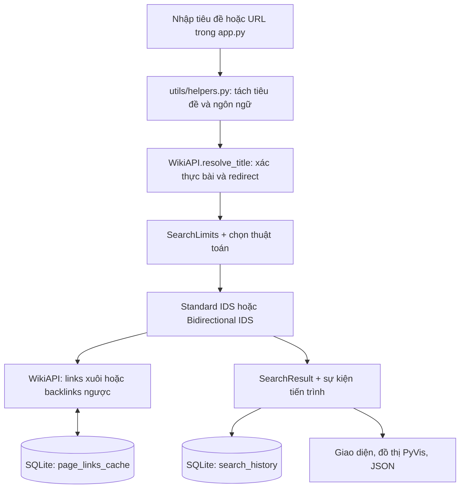

# SixDegreesOfWiki

Ứng dụng tìm đường liên kết giữa hai bài Wikipedia bằng **Standard IDS** và **Bidirectional IDS** trên đồ thị có hướng. Một đỉnh là bài viết thuộc namespace 0; cạnh `A → B` tồn tại khi bài A liên kết tới bài B. Ứng dụng hỗ trợ Wikipedia tiếng Việt (`vi`) và tiếng Anh (`en`). Cache và lịch sử tìm kiếm đều dùng **SQLite**; không cần MySQL.

README này dành cho thành viên muốn chạy, kiểm thử hoặc sửa mã. [DEMO.md](DEMO.md) là kịch bản trình bày ngắn; [PROGRESS.md](PROGRESS.md) ghi tiến độ; [PROJECT_PLAN.md](PROJECT_PLAN.md) là kế hoạch ban đầu và còn nhắc tới MySQL, không phản ánh kiến trúc hiện tại.

## Mục tiêu và phạm vi

- Tìm một đường đi ngắn nhất theo số cạnh trong dữ liệu liên kết mà MediaWiki API trả về, nếu quá trình tìm kiếm hoàn tất trong các giới hạn đã chọn.
- So sánh hai cách duyệt IDS, quan sát mức sâu, số lần thăm/mở rộng, thời gian và lượt dùng cache.
- Lưu từng lần chạy và danh sách liên kết đã tải đầy đủ để có thể xem lại hoặc xuất báo cáo JSON.

Đường đi có **hướng**: `A → B` không suy ra `B → A`. Ứng dụng không tìm đường nối giữa hai phiên bản ngôn ngữ khác nhau. Nội dung Wikipedia thay đổi theo thời gian nên cùng một cặp bài có thể cho kết quả hoặc số liệu khác nhau.

## Chức năng

- Nhập tiêu đề hoặc dán URL bài viết (`https://en.wikipedia.org/wiki/World_War_II`), nhận gợi ý tiêu đề và xác thực bài viết thuộc namespace 0. Ngôn ngữ của URL được nhận diện tự động.
- Chạy từng thuật toán hoặc so sánh cả hai; chọn giới hạn độ sâu, thời gian, số trạng thái thăm hoặc bật chế độ không giới hạn.
- Tùy biến **4 phong cách hiển thị (Themes)**: *Cosmic Deep Space (Tối vũ trụ)*, *NieR: Automata (Sáng hoài niệm / YoRHa)*, *Cyberpunk Slate (Tối công nghệ)*, *Clean Paper (Sáng tối giản)*, tự động tiêm CSS động can thiệp toàn bộ trang và thanh điều khiển.
- Hiển thị đường đi bằng **Thanh hành trình liên kết (Connected Path Stepper)** với bộ biểu tượng vector SVG tự thiết kế (Khởi hành, Bước chuyển tiếp, Đích đến, Mũi tên dẫn hướng, Mở liên kết ngoài).
- Trực quan hóa **Đồ thị tương tác PyVis / Vis.js** với thuật toán ổn định lực vật lý Barnes-Hut, phân biệt màu sắc nút theo theme, và tính năng **Click-to-Wiki** (nhấp vào bất kỳ nút nào trên đồ thị hoặc hành trình đều mở ngay bài viết trên Wikipedia trong tab mới).
- Xem đường đi, số bài trung gian, thời gian, nút đã thăm, nút mở rộng và tỷ lệ cache hit.
- Theo dõi trực tiếp mức sâu, chiều duyệt, bài đang xử lý, số nút và cache khi thuật toán chạy. Giao diện lấy mẫu sự kiện khoảng 4 lần/giây để tránh làm chậm tìm kiếm; đây không phải nhật ký của mọi nút. Thời gian dựng khung tiến trình được trừ khỏi thời gian tìm kiếm báo cáo.
- Xem lịch sử tìm kiếm trong SQLite và tải báo cáo JSON của kết quả hiện tại hoặc phiên cũ.

Các trạng thái kết quả:

| Trạng thái | Ý nghĩa |
| --- | --- |
| `found` | Đã tìm thấy đường đi; `depth` là số cạnh, bằng số bài trong đường đi trừ 1. |
| `not_found` | Đã duyệt xong đến độ sâu tối đa đã chọn nhưng chưa tìm thấy; không khẳng định không có đường dài hơn. |
| `timeout` | Hết thời gian tìm kiếm; kết quả chưa xác định. |
| `node_limit` | Đạt giới hạn lượt thăm nút; kết quả chưa xác định. |

`nodes_visited` đếm **lượt thăm** khi duyệt, nên cùng bài có thể được tính nhiều lần ở các nhánh hoặc mức sâu khác nhau. `expanded_nodes` đếm lượt mở rộng để lấy láng giềng. Cache hit/miss đếm lần yêu cầu một **danh sách liên kết** từ cache/API, không phải số trang HTTP được tải.

Hai thuật toán chạy đúng vòng lặp độ sâu của mình, không dùng bước kiểm tra nhanh đường dài 1–2 cạnh hay ưu tiên tiêu đề liên quan. Bidirectional IDS cho phía xuất phát đi thêm bước ở độ sâu lẻ, dùng lại kết quả phía xuất phát khi mức sâu phía đó chưa đổi, và dừng ngay khi hai phía gặp nhau. Backlinks được đọc theo từng trang API; chỉ danh sách đã tải đầy đủ mới được ghi vào SQLite. Các thay đổi này giữ thứ tự thử độ sâu tăng dần và kết quả đường ngắn nhất. Cache SQLite giảm số lần tải lại cùng danh sách liên kết.

Chế độ **Không giới hạn** bỏ ba ngưỡng của thuật toán: độ sâu, thời gian tìm kiếm và lượt thăm nút. Timeout của từng HTTP request vẫn còn; CPU, bộ nhớ và giới hạn Python/API cũng vẫn áp dụng. Truy vấn không giới hạn có thể chạy rất lâu. Dừng máy chủ trong terminal bằng `Ctrl+C` khi cần.

## Cài đặt và chạy

Cần **Python 3.11 trở lên** (nhóm đã kiểm tra với 3.12), Git để lấy mã và Internet khi xác thực bài hoặc tải liên kết từ Wikipedia. Các kiểm thử đơn vị dùng dữ liệu giả lập được mô tả ở phần [Kiểm thử](#kiểm-thử).

### Windows PowerShell

```powershell
git clone https://github.com/Fiwpr06/SixDegreesOfWiki.git
cd SixDegreesOfWiki
python --version
python -m venv .venv
& .\.venv\Scripts\python.exe -m pip install -r requirements.txt
& .\.venv\Scripts\python.exe -m streamlit run app.py --server.address 127.0.0.1
```

Nếu đã có thư mục dự án, bắt đầu từ `cd` vào thư mục chứa `app.py`; không cần clone lần nữa. Nếu `python` trỏ tới Microsoft Store, chọn Python 3.11+ đã cài bằng `py -3.12 -m venv .venv` hoặc đường dẫn thật tới `python.exe`.

### macOS/Linux

```bash
git clone https://github.com/Fiwpr06/SixDegreesOfWiki.git
cd SixDegreesOfWiki
python3 --version
python3 -m venv .venv
.venv/bin/python -m pip install -r requirements.txt
.venv/bin/python -m streamlit run app.py --server.address 127.0.0.1
```

Mở [http://127.0.0.1:8501](http://127.0.0.1:8501). Dừng máy chủ bằng `Ctrl+C`. Luôn chạy lệnh ở **thư mục gốc dự án** để Python tìm thấy các gói `core`, `database` và `utils`.

### Cấu hình cá nhân

Không cần `.env` để chạy với mặc định. Nếu muốn đổi cấu hình, trên PowerShell dùng `Copy-Item .env.example .env`, rồi sửa `.env`. `config.py` đọc file này; biến môi trường của terminal có ưu tiên hơn giá trị trong `.env`.

| Biến trong `.env.example` | Mặc định | Tác dụng |
| --- | ---: | --- |
| `SQLITE_PATH` | `wiki_cache.db` | File SQLite; đường dẫn tương đối được tính từ thư mục gốc dự án. |
| `WIKI_REQUEST_TIMEOUT_SECONDS` | `15` | Timeout cho **mỗi** HTTP request tới MediaWiki, không phải toàn bộ lượt tìm kiếm. |
| `WIKI_CACHE_TTL_SECONDS` | `604800` | Thời gian sống của danh sách liên kết đã cache, tính bằng giây (7 ngày). |
| `DEFAULT_MAX_DEPTH` | `3` | Độ sâu mặc định trên giao diện, từ 0 đến 6. |
| `DEFAULT_TIMEOUT_SECONDS` | `30` | Giới hạn thời gian tìm kiếm mặc định, tính bằng giây. |
| `DEFAULT_MAX_VISITED_NODES` | `2000` | Số lượt thăm nút tối đa mặc định. |

Các giá trị `DEFAULT_*` chỉ khởi tạo điều khiển giao diện; người dùng vẫn có thể đổi khi chạy. `SearchLimits` ở `core/search_types.py` kiểm tra giá trị hợp lệ, còn `app.py` giới hạn phạm vi của slider/ô nhập. Sau khi đổi `.env` hoặc đường dẫn SQLite, **khởi động lại Streamlit** vì kết nối DB được giữ bằng `st.cache_resource`.

Để mỗi thành viên có DB riêng trong một phiên PowerShell, đặt biến trước khi khởi động:

```powershell
$env:SQLITE_PATH = "wiki_cache_ca_nhan.db"
& .\.venv\Scripts\python.exe -m streamlit run app.py --server.address 127.0.0.1
# Sau khi dừng app, bỏ biến của phiên terminal nếu cần:
Remove-Item Env:SQLITE_PATH
```

`.env`, `.venv` và các file `*.db` đã nằm trong `.gitignore`; không đưa DB cá nhân lên Git.

## Demo nhanh

1. Trong sidebar chọn `en`, **Bidirectional IDS**, độ sâu tối đa `1`.
2. Nhập `Python (programming language)` và `ADMB`, rồi bấm **Bắt đầu phân tích liên kết**. Có thể dán URL đầy đủ; ví dụ `https://en.wikipedia.org/wiki/World_War_II` được nhận thành `World War II`, không bị cắt ở dấu `_`.
3. Xem đường đi `Python (programming language) → ADMB`, độ sâu 1, số bài trung gian 0, đồ thị và báo cáo JSON. Dữ liệu Wikipedia có thể thay đổi.
4. Đổi sang **So sánh cả hai** để thấy Standard IDS và Bidirectional IDS chạy lần lượt. Thuật toán thứ hai dùng chung cache đã được thuật toán thứ nhất tạo, nên thời gian của hai cột không phải phép đo trên hai cache lạnh độc lập.

Để thử một đường 2 bước, chọn riêng Bidirectional IDS với giới hạn mặc định và nhập `World War II` → `Japan` trên Wikipedia tiếng Anh. Lần kiểm chứng ngày 07/11/2026 tìm được `World War II → Buddhist philosophy → Japan`; đường đi thực tế có thể đổi. Xem [DEMO.md](DEMO.md) để có kịch bản trình bày đầy đủ.

## Luồng xử lý



1. `utils/helpers.py` chấp nhận tiêu đề thường hoặc URL `/wiki/...` của `vi.wikipedia.org`/`en.wikipedia.org`. Hai URL ở hai ngôn ngữ khác nhau bị từ chối; URL một ngôn ngữ sẽ quyết định ngôn ngữ tìm kiếm.
2. `WikiAPI.resolve_title()` xác thực bài thuộc namespace 0 và lấy tiêu đề chuẩn sau redirect. Gợi ý khi gõ dùng `prefixsearch`; giao diện cache gợi ý trong một giờ.
3. Thuật toán yêu cầu `forward` (liên kết đi ra) hoặc `backward` (các bài trỏ tới đích). `core/wiki_api.py` lọc namespace 0, theo phân trang MediaWiki và lưu danh sách đầy đủ vào SQLite theo khóa `(title, lang, direction)`.
4. `SearchTracker` kiểm tra giới hạn, đếm lượt thăm/mở rộng và phát mẫu tiến trình khoảng mỗi 0,25 giây. `app.py` lưu kết quả từng thuật toán vào `search_history`, sau đó dựng giao diện, đồ thị và báo cáo.

### Hai thuật toán

| Thành phần | Cách duyệt | Lưu ý khi sửa |
| --- | --- | --- |
| `core/ids_search.py` | Standard IDS: chạy DFS giới hạn độ sâu từ 0 đến mức tối đa, tăng dần từng mức; chỉ đi theo cạnh xuôi. | Cùng nút có thể được thăm lại ở mức sâu mới; giữ kiểm tra chu trình trên đường hiện tại. |
| `core/bidirectional_ids.py` | Bidirectional IDS: duyệt xuôi từ đầu và ngược qua backlinks từ đích. Với tổng độ sâu `d`, phía xuôi nhận `(d + 1) // 2`, phía ngược nhận `d // 2`. | Dùng lại phần xuôi nếu mức sâu của phía đó không đổi; kiểm tra điểm giao ngay khi duyệt và chỉ nối các cạnh đúng chiều. |
| `core/search_types.py` | `SearchLimits`, `SearchResult`, `SearchProgress`, `SearchTracker`. | Đây là nơi xác định trạng thái, đếm nút và trừ thời gian dựng giao diện khỏi số giây tìm kiếm. |

Bidirectional IDS đọc liên kết qua `WikiAPI.iter_links()`, nên có thể dừng khi một trang API vừa trả về điểm giao. Danh sách mới chỉ được ghi cache **sau khi đọc hết**; nếu tìm thấy sớm thì phần đã đọc dở không trở thành một cache thiếu dữ liệu. Standard IDS dùng `get_links()` để nhận danh sách đầy đủ. Hai thuật toán không được cấp trước bài trung gian hay dùng heuristic theo tên bài.

### Nghiên cứu thực nghiệm & Phân tích giới hạn: Case study Võ Nguyên Giáp → Siêu tân tinh

Một trong những phát hiện thực nghiệm quan trọng của dự án là việc kiểm chứng giới hạn lý thuyết của Standard IDS đối với đồ thị phân nhánh thế giới thực:

* **Bài toán thử nghiệm**: Tìm đường đi từ `Võ Nguyên Giáp` đến `Siêu tân tinh` trên Wikipedia tiếng Việt (`vi`).
* **Đường đi thực tế**: `Võ Nguyên Giáp → Vật lý học → Siêu tân tinh` (Độ sâu 2, qua 1 bài trung gian).
  * *Lưu ý về liên kết bí danh (Alias link)*: Trên bài viết Wikipedia [Võ Nguyên Giáp](https://vi.wikipedia.org/wiki/V%C3%B5_Nguy%C3%AAn_Gi%C3%A1p), phần tiểu sử gia đình có đoạn: *"...Võ Hồng Anh là một giáo sư, tiến sĩ khoa học ngành **Toán - lý** đã từng đoạt giải thưởng Kovalevskaia..."*. Mã nguồn wikitext thực tế là `[[vật lý học|lý]]`. Do đó, người dùng bấm `Ctrl + F` tìm "Vật lý học" trên trình duyệt sẽ không thấy, nhưng nhấp chuột vào chữ `"lý"` sẽ điều hướng trực tiếp đến bài `Vật lý học`. Từ bài `Vật lý học`, liên kết trỏ thẳng tới `Siêu tân tinh`.
* **Kết quả so sánh giữa hai thuật toán**:
  * **Bidirectional IDS**: Tìm thấy ngay đường đi ở độ sâu 2 chỉ sau **627 nút thăm** và **0,53 giây**. Phía xuôi duyệt $d=1$ lấy 621 liên kết của `Võ Nguyên Giáp` (trong đó có `Vật lý học`); phía ngược duyệt $d=1$ từ `Siêu tân tinh` phát hiện ngay điểm giao `Vật lý học`.
  * **Standard IDS**: Bị dừng cưỡng bức (`status = "node_limit"` hoặc `"timeout"`) ở độ sâu 2 dù đặt giới hạn lên tới 6.
* **Nguyên nhân cốt lõi**:
  1. `Võ Nguyên Giáp` có **621 liên kết xuôi**. Do MediaWiki API trả về danh sách theo thứ tự từ điển A–Z (số/ngày tháng đứng đầu, chữ V đứng gần cuối), bài `Vật lý học` nằm ở **vị trí 559**. Kể cả khi lọc bỏ 73 bài ngày tháng rác, vẫn còn **486 bài viết** đứng trước nó.
  2. Standard IDS sử dụng duyệt theo chiều sâu (DFS): Trước khi xét tới nhánh thứ 486 (`Vật lý học`), DFS phải đào sâu và mở rộng toàn bộ các nhánh con của 486 bài đứng trước (`ASP.NET`, `Alexandros Đại đế`, `Algérie`...). Với trung bình 275 liên kết/bài, Standard IDS cần duyệt qua hơn **133.000 nút** mới tới được `Vật lý học`.
  3. Khi giới hạn an toàn là 2.000 nút, Standard IDS chỉ mới kịp duyệt qua 4 nhánh con đầu tiên thì đã chạm ngưỡng dừng.
* **Bài học rút ra**: Trên các mạng thông tin khổng lồ như Wikipedia (hệ số phân nhánh $b \approx 300$), **Bidirectional Search** là giải pháp vượt trội bắt buộc để triệt tiêu số mũ từ $\mathcal{O}(b^d)$ xuống $\mathcal{O}(2 \cdot b^{d/2})$.

### Hệ thống 4 phong cách hiển thị (Themes)

Giao diện hỗ trợ 4 phong cách màu sắc tương thích hoàn toàn trên cả màn hình tối và sáng:

1. **Cosmic Deep Space (Tối vũ trụ)**: Tông màu đen sâu thẳm `#0b0d17`, điểm xuyết ánh sáng Supernova Cyan `#00d2e6` và tím tinh vân `#a855f7`.
2. **NieR: Automata (Sáng hoài niệm / YoRHa)**: Phong cách quân đội YoRHa tông màu be sáng `#e5e0d8`, viền xám olive nhạt và chữ nâu than tối, mang lại cảm giác dịu mắt.
3. **Cyberpunk Slate (Tối công nghệ)**: Tông màu than chì phiến đêm `#0b0e14`, viền sắc nét `#2a354c`, ánh sáng Neon Sky `#38bdf8` và Emerald `#10b981`.
4. **Clean Paper (Sáng tối giản)**: Tông màu giấy ngọc trai `#f8fafc`, nền thẻ trắng tinh khôi `#ffffff`, chữ sapphire đậm `#0f172a` với độ tương phản cao đạt chuẩn văn phòng.

Bộ điều khiển CSS tiêm động xử lý đồng bộ toàn bộ thành phần giao diện Streamlit 1.65 (Selectbox, Combobox, Virtual Dropdown, NumberInput stepper buttons) để đảm bảo không bị lỗi chữ chìm hay ô đen trên nền sáng.

## Kiểm thử

Chạy từ thư mục gốc dự án. Trên macOS/Linux, thay `& .\.venv\Scripts\python.exe` bằng `.venv/bin/python`.

```powershell
# Toàn bộ bộ kiểm thử:
& .\.venv\Scripts\python.exe -m unittest discover -s tests -v

# Chỉ kiểm thử thuật toán, parser URL và MediaWiki API giả lập:
& .\.venv\Scripts\python.exe -m unittest tests.test_search tests.test_helpers tests.test_wiki_api -v

# Chạy một ca khi đang sửa Bidirectional IDS:
& .\.venv\Scripts\python.exe -m unittest tests.test_wiki_api.WikiAPITests.test_streaming_backlinks_stops_at_meeting_page -v
```

`tests/test_search.py` dùng đồ thị có hướng nhỏ và đối chiếu độ dài đường đi với BFS trên 30 đồ thị sinh ngẫu nhiên; nó không gọi Wikipedia. `tests/test_wiki_api.py` giả lập response, phân trang và cache trong DB tạm. `tests/test_helpers.py` kiểm tra URL có nhiều dấu `_`. `tests/test_app.py` dùng Streamlit AppTest và mock API, không cần Internet nhưng cần môi trường cho phép socket cục bộ. Nếu bộ đầy đủ treo ở AppTest trong sandbox, chạy lệnh kiểm thử đơn vị bên trên ở terminal thông thường.

Kiểm thử tự động xác nhận logic với dữ liệu giả lập; kiểm thử tích hợp với Wikipedia thật cần Internet và có thể chịu thay đổi của API. `demo_stage1.py` kiểm tra tầng API/cache:

```powershell
& .\.venv\Scripts\python.exe .\demo_stage1.py ADMB --lang en
```

Ca chạy thật trong giao diện nên dùng DB cá nhân và ghi lại `status`, đường đi, giới hạn, thời gian, số nút, cache hit/miss. Nếu đổi thuật toán, đối chiếu đường đi với kiểm tra cạnh xuôi `A → B` ở từng bước, rồi chạy lại các test trên.

## SQLite và cache

`Database()` tạo file SQLite khi ứng dụng khởi động. Hai bảng chính:

| Bảng | Nội dung |
| --- | --- |
| `page_links_cache` | Danh sách links hoặc backlinks theo tiêu đề, ngôn ngữ và chiều; có `link_count`, `updated_at` để kiểm tra TTL. |
| `search_history` | Bài đầu/đích, thuật toán, trạng thái, đường đi JSON, độ sâu và chỉ số từng lần chạy. |

Muốn xem `.db` trong VS Code, dùng một tiện ích xem SQLite để mở file được đặt ở `SQLITE_PATH`, hoặc dùng Python có sẵn mà không phải cài tiện ích. Dừng app trước khi sửa DB trực tiếp. Ví dụ đọc DB mặc định ở chế độ **chỉ đọc** từ Python REPL:

```powershell
& .\.venv\Scripts\python.exe
```

```python
import sqlite3
db = sqlite3.connect("file:wiki_cache.db?mode=ro", uri=True)
db.execute("SELECT name FROM sqlite_master WHERE type = 'table'").fetchall()
db.execute("SELECT id, algorithm, status, start_title, target_title FROM search_history ORDER BY id DESC LIMIT 5").fetchall()
db.execute("SELECT title, direction, link_count FROM page_links_cache LIMIT 5").fetchall()
db.close()
```

Để kiểm thử lại với cache trống mà vẫn giữ lịch sử cũ, **dừng app** rồi xóa các dòng `page_links_cache` trong DB cá nhân; để làm lại cả cache lẫn lịch sử, đổi `SQLITE_PATH` sang một tên file mới. Không xóa DB đang dùng nếu còn cần lịch sử. TTL mặc định là 7 ngày; cache hết hạn sẽ được tải lại. `cache_miss` có thể tăng dù đường đi được tìm rất nhanh vì một danh sách đọc dở không được lưu.

## Chỗ cần sửa khi tùy chỉnh

| Thành phần | Vai trò |
| --- | --- |
| `app.py` | Nhãn, form, lựa chọn thuật toán, giới hạn trên UI, tiến trình, bảng so sánh, lịch sử và nút tải JSON. |
| `config.py`, `.env.example` | Giá trị mặc định, đường dẫn SQLite, timeout HTTP và TTL. Khi đổi phạm vi độ sâu/số nút, kiểm tra cả validation trong `core/search_types.py` và widget trong `app.py`. |
| `core/ids_search.py`, `core/bidirectional_ids.py` | Thứ tự duyệt, điều kiện dừng, cách nối đường. Sửa cùng các ca trong `tests/test_search.py`; với streaming API, bổ sung `tests/test_wiki_api.py`. |
| `core/wiki_api.py` | Xác thực tiêu đề, MediaWiki query, phân trang và cache. Giữ lọc namespace 0 và không cache response thiếu. |
| `core/visualizer.py` | Màu/nút/cạnh của đồ thị PyVis. Chỉ hiển thị một mẫu cạnh để đồ thị không quá lớn. |
| `database/models.py`, `database/connection.py`, `database/history.py` | Schema, nâng cấp DB cũ và ghi/đọc lịch sử. Khi thêm cột, cần cập nhật migration và test DB cũ. |
| `utils/helpers.py`, `utils/exporter.py` | Tách URL/tiêu đề và cấu trúc báo cáo JSON. Giữ nguyên dấu `_` trong URL đầu vào cho tới khi parser đọc hết đường dẫn. |
| `tests/` | Test thuật toán, API/cache, parser và smoke test giao diện. |

Quy trình sửa nhỏ: tạo DB riêng qua `SQLITE_PATH`; sửa đúng module; thêm ca test cho hành vi mới và ca lỗi cũ; chạy test liên quan rồi toàn bộ suite; cuối cùng thử một cặp bài thật trong giao diện. Nếu thay đổi đường đi hoặc chỉ số báo cáo, cập nhật README/DEMO để thành viên khác dùng cùng kỳ vọng.

## Xử lý sự cố thường gặp

| Hiện tượng | Kiểm tra |
| --- | --- |
| `ModuleNotFoundError` | Đã cài `requirements.txt` trong `.venv` và chạy lệnh từ thư mục chứa `app.py` chưa? |
| URL `World_War_II` hiển thị sai | Dán URL đầy đủ; kiểm tra parser tại `utils/helpers.py` và chạy `tests.test_helpers`. |
| `timeout` hoặc `node_limit` | Đây là kết quả chưa xác định; tăng đúng giới hạn trong sidebar, xem khung tiến trình để biết bước nào chậm. |
| API lỗi hoặc gợi ý không tải | Kiểm tra Internet, URL Wikipedia, ngôn ngữ `vi`/`en` và `WIKI_REQUEST_TIMEOUT_SECONDS`. |
| Cache hit thấp | Kiểm tra `SQLITE_PATH`, TTL, chiều `forward`/`backward`; lượt tìm thấy sớm không ghi danh sách chưa hoàn chỉnh. |
| File DB không thấy | Đường dẫn tương đối tính từ thư mục dự án; kiểm tra `SQLITE_PATH` và khởi động lại Streamlit sau khi đổi. |
| Kết quả so sánh hai thuật toán khác thời gian nhiều | Chế độ so sánh chạy Standard IDS trước rồi Bidirectional IDS, dùng chung SQLite cache. |
