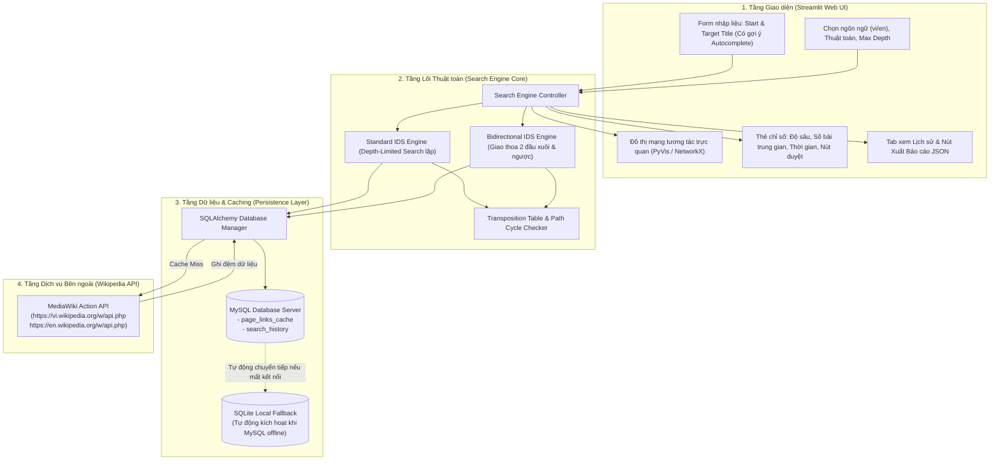
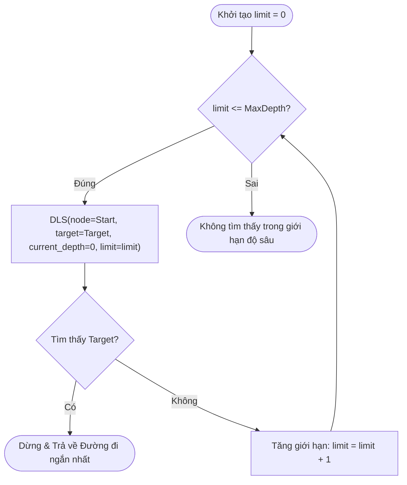
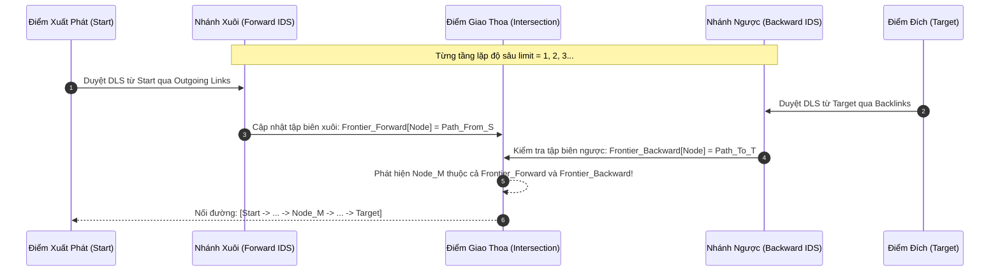

# SIXDEGREESOFWIKI: HỆ THỐNG PHÂN TÍCH LIÊN KẾT BÀI VIẾT WIKIPEDIA
## DỰA TRÊN THUẬT TOÁN ITERATIVE DEEPENING SEARCH (IDS)

---

## 1. TỔNG QUAN ĐỀ TÀI & BỐI CẢNH

### 1.1. Giới thiệu đề tài
Trên không gian mạng Internet, Wikipedia được xem là bách khoa toàn thư mở đồ sộ nhất của nhân loại, chứa hàng chục triệu bài viết được kết nối chéo với nhau qua các siêu liên kết (hyperlinks). Đề tài này mô hình hóa kho tri thức Wikipedia dưới dạng **đồ thị có hướng khổng lồ** $G = (V, E)$, trong đó:
- Tập đỉnh $V$: Mỗi đỉnh đại diện cho một bài viết Wikipedia bách khoa (Namespace 0).
- Tập cạnh $E$: Mỗi cạnh $(u, v)$ thể hiện một siêu liên kết từ bài viết $u$ trỏ tới bài viết $v$.

Đề tài giải quyết bài toán kinh điển **"Six Degrees of Wikipedia"** (Trò chơi Wikipedia Game): Xuất phát từ một bài viết bất kỳ $S$, cần phải đi qua **bao nhiêu bài báo trung gian** và theo **con đường nào** để đến được bài viết đích $T$ trong thời gian ngắn nhất.

### 1.2. Mục tiêu dự án
1. **Đầu vào (Input)**:
   - Tiêu đề 2 bài viết: Bài viết xuất phát ($S$) và Bài viết đích ($T$).
   - Lựa chọn ngôn ngữ: Tiếng Việt (`vi.wikipedia.org`) hoặc Tiếng Anh (`en.wikipedia.org`).
   - Lựa chọn thuật toán: **Standard IDS**, **Bidirectional IDS**, hoặc **So sánh cả hai**.
   - Cấu hình giới hạn: Độ sâu tối đa ($\text{Max Depth}$), giới hạn thời gian (Timeout).

2. **Xử lý (Processing)**:
   - Giao tiếp với **MediaWiki Action API** để thu thập danh sách liên kết xuôi (`prop=links`) và liên kết ngược (`list=backlinks`).
   - Lọc sạch toàn bộ các không gian tên kỹ thuật (loại trừ `Category:`, `Portal:`, `Help:`, `File:`, `Wikipedia:`, `Template:`), chỉ giữ lại bài viết bách khoa thuần túy.
   - Ứng dụng giải thuật **Iterative Deepening Search (IDS)** và biến thể tối ưu **Bidirectional IDS**.
   - Lưu trữ đệm (Caching) thông minh qua **MySQL** (kèm cơ chế tự động chuyển sang **SQLite** nếu máy trạm chưa khởi chạy service MySQL) để loại trừ độ trễ mạng khi duyệt lại các nút.

3. **Đầu ra (Output)**:
   - **Độ sâu tìm kiếm ($d$)**: Khoảng cách ngắn nhất giữa 2 bài viết.
   - **Số bài báo trung gian**: Bằng $d - 1$ bài viết.
   - **Chuỗi đường đi cụ thể**:
     $$S \rightarrow \text{Bài báo trung gian 1} \rightarrow \text{Bài báo trung gian 2} \rightarrow \dots \rightarrow T$$
   - **Bảng đối chiếu hiệu năng**: So sánh thời gian thực thi (ms), số nút đã mở rộng (Expanded Nodes), tỷ lệ Cache Hit giữa Standard IDS và Bidirectional IDS.
   - **Trực quan hóa đồ thị (Interactive Graph Visualization)**: Dựng mạng liên kết dạng đồ thị tương tác (zoom, xoay, kéo thả) làm nổi bật con đường ngắn nhất bằng thư viện **PyVis**.
   - **Lịch sử tìm kiếm & Xuất báo cáo**: Quản lý lịch sử các phiên tra cứu trong CSDL và cho phép xuất toàn bộ kết quả phân tích ra file định dạng **JSON**.

---

## 2. KIẾN TRÚC HỆ THỐNG (SYSTEM ARCHITECTURE)

Hệ thống được thiết kế theo kiến trúc phân tầng (Layered Architecture) tách biệt giữa Giao diện, Lõi thuật toán, Tầng truy xuất dữ liệu và Tầng lưu trữ:



---

## 3. CƠ SỞ LÝ THUYẾT & THUẬT TOÁN TÌM KIẾM

### 3.1. Thuật toán Iterative Deepening Search (IDS)

#### a. Nguyên lý hoạt động
Iterative Deepening Search (IDS) là thuật toán tìm kiếm mù (uninformed search) kết hợp hoàn hảo ưu điểm của:
- **Breadth-First Search (BFS)**: Đảm bảo tính **Đầy đủ (Completeness)** và tính **Tối ưu (Optimality)** (luôn tìm ra đường đi ngắn nhất trên đồ thị có trọng số cạnh bằng nhau).
- **Depth-First Search (DFS)**: Tiết kiệm bộ nhớ vượt trội, độ phức tạp không gian chỉ là tuyến tính $O(b \cdot d)$ thay vì hàm mũ $O(b^d)$ của BFS.

IDS thực hiện lặp qua từng mức giới hạn độ sâu $\text{limit} = 0, 1, 2, 3, \dots, \text{MaxDepth}$. Tại mỗi mức giới hạn, thuật toán chạy **Depth-Limited Search (DLS)** từ nút gốc.



#### b. Mã giả thuật toán Standard IDS:
```python
def iterative_deepening_search(start, target, max_depth):
    for limit in range(max_depth + 1):
        visited_in_path = set()
        path = depth_limited_search(start, target, limit, visited_in_path)
        if path is not None:
            return path  # Đường đi ngắn nhất tìm được
    return None

def depth_limited_search(current, target, limit, visited_in_path):
    if current == target:
        return [current]
    if limit == 0:
        return None
    
    visited_in_path.add(current)
    neighbors = get_outgoing_links(current)  # Đọc từ MySQL cache hoặc gọi API
    
    for neighbor in neighbors:
        if neighbor not in visited_in_path:
            result = depth_limited_search(neighbor, target, limit - 1, visited_in_path)
            if result is not None:
                return [current] + result
                
    visited_in_path.remove(current)  # Backtrack
    return None
```

---

### 3.2. Thuật toán Bidirectional Iterative Deepening Search (Bidirectional IDS)

#### a. Tại sao cần Bidirectional IDS trên đồ thị Wikipedia?
Wikipedia là đồ thị có hệ số phân nhánh (Branching Factor $b$) rất lớn, trung bình $b \approx 100 - 300$ liên kết trên mỗi bài viết:
- Với **Standard IDS**, ở độ sâu $d = 4$, số lượng trạng thái cần duyệt lên tới:
  $$b^d \approx 100^4 = 100.000.000 \text{ nút}$$
  Dù có cache, việc duyệt hàng triệu nút qua internet là bất khả thi trong thời gian thực.
- Với **Bidirectional IDS**, thuật toán tìm kiếm đồng thời từ 2 phía:
  1. **Nhánh xuôi (Forward Search)**: Xuất phát từ $S$, đi qua các liên kết ra (`outgoing links`).
  2. **Nhánh ngược (Backward Search)**: Xuất phát từ $T$, đi ngược qua các liên kết vào (`incoming links / backlinks`).
  
Hai nhánh tìm kiếm gặp nhau ở giữa tại một đỉnh trung gian chung $M$. Khi đó độ sâu mỗi nhánh chỉ là $d/2$:
$$2 \times b^{d/2} \approx 2 \times 100^2 = 20.000 \text{ nút}$$
Tốc độ tìm kiếm được tăng tốc gấp **5.000 lần**!



---

## 4. ĐẶC TẢ CƠ SỞ DỮ LIỆU MYSQL (PERSISTENCE & CACHE SCHEMA)

Hệ thống sử dụng ORM **SQLAlchemy** để tương thích hoàn toàn với MySQL (khi có service) và tự động chuyển sang SQLite (nếu chưa khởi chạy MySQL).

### 4.1. Bảng `page_links_cache`
Lưu đệm danh sách siêu liên kết của từng trang để loại bỏ hoàn toàn việc gọi lại API MediaWiki:
```sql
CREATE TABLE page_links_cache (
    id INT AUTO_INCREMENT PRIMARY KEY,
    title VARCHAR(255) NOT NULL,
    lang VARCHAR(10) NOT NULL DEFAULT 'vi',
    direction ENUM('forward', 'backward') NOT NULL DEFAULT 'forward',
    links_json LONGTEXT NOT NULL,
    link_count INT NOT NULL DEFAULT 0,
    created_at DATETIME DEFAULT CURRENT_TIMESTAMP,
    updated_at DATETIME DEFAULT CURRENT_TIMESTAMP ON UPDATE CURRENT_TIMESTAMP,
    INDEX idx_title_lang_dir (title, lang, direction)
) ENGINE=InnoDB DEFAULT CHARSET=utf8mb4 COLLATE=utf8mb4_unicode_ci;
```

### 4.2. Bảng `search_history`
Lưu vết toàn bộ lịch sử các truy vấn của người dùng phục vụ thống kê, báo cáo:
```sql
CREATE TABLE search_history (
    id INT AUTO_INCREMENT PRIMARY KEY,
    start_title VARCHAR(255) NOT NULL,
    target_title VARCHAR(255) NOT NULL,
    lang VARCHAR(10) NOT NULL DEFAULT 'vi',
    algorithm VARCHAR(50) NOT NULL,
    depth INT NOT NULL,
    intermediate_count INT NOT NULL,
    path_json TEXT NOT NULL,
    execution_time FLOAT NOT NULL,
    nodes_visited INT NOT NULL,
    created_at DATETIME DEFAULT CURRENT_TIMESTAMP,
    INDEX idx_query_time (created_at)
) ENGINE=InnoDB DEFAULT CHARSET=utf8mb4 COLLATE=utf8mb4_unicode_ci;
```

---

## 5. CẤU TRÚC MÃ NGUỒN DỰ ÁN

```
d:\Workspace\University\WikiAI/
│
├── .env.example                  # Mẫu cấu hình tham số môi trường và CSDL
├── .env                          # File cấu hình nội bộ (MySQL host, user, pass, db)
├── requirements.txt              # Danh sách các thư viện phụ thuộc Python
├── README.md                     # Tài liệu đặc tả kỹ thuật toàn diện của dự án
├── app.py                        # Điểm khởi chạy chính của ứng dụng Web Streamlit
├── config.py                     # Quản lý cài đặt cấu hình (ConfigLoader)
│
├── database/                     # Phân tầng Quản lý Cơ sở Dữ liệu
│   ├── __init__.py
│   ├── connection.py             # Kết nối SQLAlchemy (Hỗ trợ MySQL + Auto SQLite fallback)
│   └── models.py                 # ORM Models: PageCache, SearchHistory
│
├── core/                         # Phân tầng Lõi Thuật toán & Xử lý Dữ liệu
│   ├── __init__.py
│   ├── wiki_api.py               # MediaWiki Action API Client (Namespace 0, Cache tích hợp)
│   ├── ids_search.py             # Thuật toán Standard IDS (Depth-Limited Search lặp)
│   ├── bidirectional_ids.py      # Thuật toán Bidirectional IDS (Xuôi & Ngược qua backlinks)
│   └── visualizer.py             # Sinh đồ thị mạng tương tác PyVis HTML
│
├── utils/                        # Các tiện ích bổ trợ
│   ├── __init__.py
│   ├── exporter.py               # Tiện ích xuất dữ liệu báo cáo sang file JSON / Markdown
│   └── helpers.py                # Chuẩn hóa xâu chuỗi, định dạng thời gian
│
└── tests/                        # Kiểm thử đơn vị & Benchmark
    ├── __init__.py
    └── test_search.py            # Kịch bản kiểm thử thuật toán và đo lường hiệu năng
```

---

## 6. ĐẶC TẢ CÁC TÍNH NĂNG TRÊN GIAO DIỆN WEB (STREAMLIT)

Giao diện người dùng được chia thành 3 phân vùng chính:

### 6.1. Sidebar (Bảng điều khiển thiết lập)
- **Chọn ngôn ngữ Wikipedia**: Tiếng Việt (`vi`) hoặc Tiếng Anh (`en`).
- **Chọn thuật toán**:
  - `Standard IDS` (Iterative Deepening Search cơ bản).
  - `Bidirectional IDS` (IDS 2 chiều - Khuyến nghị cho độ sâu $\ge 3$).
  - `So sánh cả hai` (Chạy song song cả 2 thuật toán trên cùng 1 cặp bài để đánh giá chênh lệch thời gian và số nút).
- **Thiết lập giới hạn**:
  - `Max Depth`: Độ sâu tối đa cho phép duyệt (mặc định $4$, tối đa $6$).
  - `Max Visited Nodes`: Tránh tràn bộ nhớ khi duyệt nhánh quá rộng.
- **Trạng thái Database**: Đèn báo hiệu trạng thái kết nối MySQL (hoặc SQLite fallback).

### 6.2. Main Area (Khu vực Tìm kiếm & Kết quả)
- **Khung nhập liệu 2 bài viết**: Có chức năng gợi ý tự động (Autocomplete) từ Wikipedia API khi gõ tên bài viết.
- **Nút hành động**: `Bắt đầu Phân tích Liên kết`.
- **Thẻ chỉ số kết quả (Metric Cards)**:
  - **Độ sâu ngắn nhất ($d$)**: Số bước nhảy tối thiểu.
  - **Số bài viết trung gian**: Hiển thị rõ số lượng bài báo trung gian cần qua ($d - 1$).
  - **Thời gian tìm kiếm**: Đo bằng giây / mili-giây.
  - **Tổng số nút duyệt**: Số bài viết đã được thăm dò trong quá trình tìm kiếm.
- **Sơ đồ chuỗi bài viết**: Trình bày rõ ràng dưới dạng Breadcrumb/Timeline:
  $$\text{Start} \xrightarrow{\quad} \text{Bài báo trung gian 1} \xrightarrow{\quad} \dots \xrightarrow{\quad} \text{Target}$$
- **Đồ thị tương tác (PyVis Graph Canvas)**:
  - Cho phép người dùng rê chuột vào từng nút để xem tóm tắt bài viết Wikipedia.
  - Các nút trên đường đi chính được tô màu nổi bật (Xanh lá / Cam), các nút nhánh phụ được làm mờ.
  - Hỗ trợ phóng to, thu nhỏ, kéo các cụm bài viết.

### 6.3. Tab Lịch sử & Báo cáo (Search History & JSON Export)
- Bảng hiển thị danh sách tất cả các lượt tìm kiếm đã lưu trong MySQL.
- Cho phép tải về toàn bộ chi tiết phiên tìm kiếm thành file `wikipedia_link_analysis_report.json` với đầy đủ siêu dữ liệu.

---

## 7. MẪU DỮ LIỆU ĐẦU RA JSON (EXPORT FORMAT)

File JSON xuất ra có cấu trúc chuẩn như sau:

```json
{
  "project": "SixDegreesOfWiki - Wikipedia Link Depth Analyzer",
  "query": {
    "start_article": "Trí tuệ nhân tạo",
    "target_article": "Toán học",
    "language": "vi",
    "algorithm_used": "Bidirectional IDS",
    "timestamp": "2026-10-25T15:45:00Z"
  },
  "results": {
    "found": true,
    "depth": 2,
    "intermediate_articles_count": 1,
    "path": [
      {
        "step": 0,
        "title": "Trí tuệ nhân tạo",
        "url": "https://vi.wikipedia.org/wiki/Tr%C3%AD_tu%E1%BB%87_nh%C3%A2n_t%E1%BA%A1o",
        "role": "START"
      },
      {
        "step": 1,
        "title": "Khoa học máy tính",
        "url": "https://vi.wikipedia.org/wiki/Khoa_h%E1%BB%8Dc_m%C3%A1y_t%C3%ADnh",
        "role": "INTERMEDIATE"
      },
      {
        "step": 2,
        "title": "Toán học",
        "url": "https://vi.wikipedia.org/wiki/To%C3%A1n_h%E1%BB%8Dc",
        "role": "TARGET"
      }
    ],
    "intermediate_articles_list": [
      "Khoa học máy tính"
    ]
  },
  "performance": {
    "execution_time_seconds": 0.428,
    "total_nodes_visited": 184,
    "cache_hit_rate_percent": 95.2,
    "database_engine": "MySQL"
  }
}
```

---

## 8. HƯỚNG DẪN CÀI ĐẶT VÀ KHỞI CHẠY (SETUP GUIDE)

### 8.1. Yêu cầu hệ thống
- Hệ điều hành: Windows 10/11, macOS, Linux.
- Python: Phiên bản **3.10** trở lên.
- CSDL (Tùy chọn): MySQL 8.0+ (nếu không cài MySQL, hệ thống tự động lưu vào file SQLite `wiki_cache.db`).

### 8.2. Cài đặt các thư viện cần thiết
```powershell
pip install -r requirements.txt
```
*Các thư viện chính bao gồm: `streamlit`, `requests`, `sqlalchemy`, `pymysql`, `pyvis`, `networkx`, `pydantic`, `python-dotenv`.*

### 8.3. Cấu hình biến môi trường
Tạo file `.env` tại thư mục gốc của dự án:
```env
# Cấu hình kết nối MySQL (Mặc định)
DB_TYPE=mysql
DB_HOST=localhost
DB_PORT=3306
DB_USER=root
DB_PASSWORD=your_password
DB_NAME=wikiai_db

# Hoặc chuyển sang SQLite nếu muốn:
# DB_TYPE=sqlite
# SQLITE_PATH=wiki_cache.db

# Giới hạn tìm kiếm mặc định
DEFAULT_MAX_DEPTH=4
DEFAULT_TIMEOUT_SECONDS=60
```

### 8.4. Khởi chạy ứng dụng Web
```powershell
streamlit run app.py
```
Ứng dụng sẽ tự động mở trên trình duyệt tại địa chỉ: `http://localhost:8501`.

---

## 9. KẾ HOẠCH TRIỂN KHAI THEO GIAI ĐOẠN (ROADMAP)

| Giai đoạn | Thời gian dự kiến | Mục tiêu chi tiết |
| :---: | :---: | :--- |
| **Giai đoạn 1** | Ngày 1 - 2 | Thiết lập cấu trúc dự án, cấu hình SQLAlchemy kết nối MySQL (kèm SQLite fallback), hoàn thiện module `wiki_api.py` tương tác MediaWiki API có bộ lọc Namespace 0 và cơ chế tự động ghi cache. |
| **Giai đoạn 2** | Ngày 3 - 4 | Cài đặt hoàn chỉnh thuật toán **Standard IDS** và **Bidirectional IDS** (xử lý duyệt xuôi và duyệt ngược qua backlinks, kiểm soát vòng lặp, tối ưu tập biên). Viết test case nghiệm thu. |
| **Giai đoạn 3** | Ngày 5 - 6 | Xây dựng giao diện Web bằng **Streamlit**, tích hợp bảng điều khiển, thẻ chỉ số phân tích, trực quan hóa đồ thị liên kết động bằng **PyVis**. |
| **Giai đoạn 4** | Ngày 7 | Hoàn thiện tính năng lưu trữ lịch sử vào MySQL, xuất báo cáo JSON, kiểm thử tải và hoàn thiện tài liệu hướng dẫn bàn giao. |

---
*Tài liệu được khởi tạo và quản lý trong dự án SixDegreesOfWiki.*
